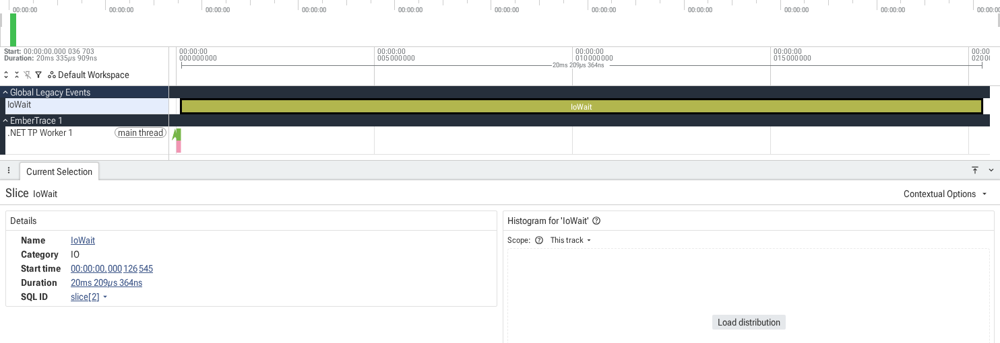
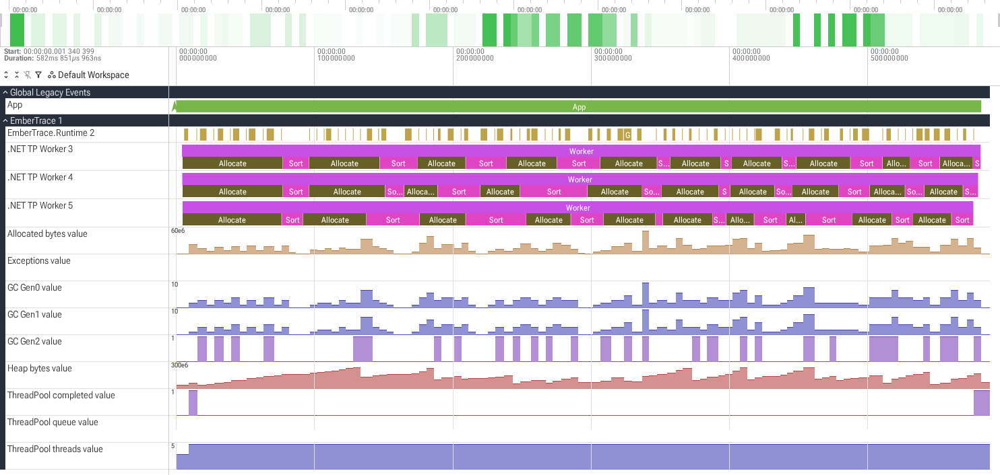
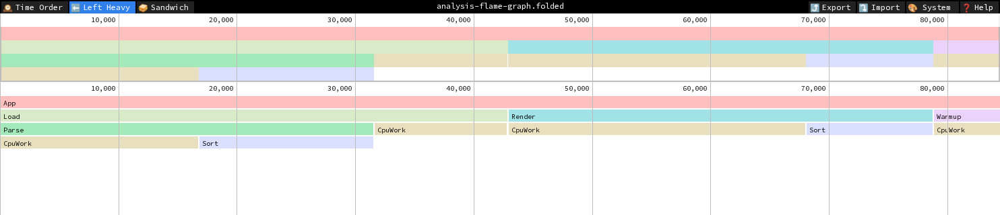

<div align="center">

[](https://www.nuget.org/packages/EmberTrace.All)

# EmberTrace

**A fast in-process tracer and profiler for .NET.**
Scopes, flows and counters on an allocation-free hot path. Reports, Perfetto traces and a flight recorder come after the fact, without touching the code that runs.

**English** · [Русский](https://github.com/Echways/EmberTrace/blob/main/README.ru.md)

[](https://www.nuget.org/packages/EmberTrace.All)
[](https://github.com/Echways/EmberTrace/actions/workflows/ci.yml)
[](https://github.com/Echways/EmberTrace/blob/main/LICENSE)

</div>

```csharp
Tracer.Start();

using (Tracer.Scope(Ids.Checkout))
{
    Checkout(order);
}

var session = Tracer.Stop();
Console.WriteLine(TraceText.Write(session.Process(), Tracer.CreateMetadata()));
```



## Why EmberTrace

A profiler is useful when you can leave it on and trust its numbers. EmberTrace keeps recording cheap and moves the work to after the session.

- **Cheap to record.** `Scope`, `Instant`, `Counter` and flow events do not allocate and take no locks: writers use thread-local buffers, and shared state is touched only when a chunk rotates or a limit is set.
- **Async-aware.** `ScopeAsync` follows a continuation across threads and keeps its parent through `await`. Flows link work that never shares a call stack.
- **Instrumentation by attribute.** `[Trace]` on a `partial` method generates the scope, the id and the metadata. On a class it generates a DI decorator for the whole service.
- **Always on.** The flight recorder keeps the last seconds in memory. `Tracer.Snapshot()` dumps them without stopping the session, and ASP.NET Core hosting can do it on demand or for every slow request.
- **Analysis after the fact.** Aggregates, percentiles with distribution shape, text reports, flame graphs and statistically sound comparison of two sets of runs.
- **Opens anywhere.** Chrome Trace and Perfetto, speedscope, OpenTelemetry spans and a compact binary `.ember` format.
- **Guards in CI.** `EmberTrace.Testing` turns a trace into assertions and regression gates.
- **Correct usage by construction.** Roslyn analyzers catch a scope that is never disposed or a flow that is never closed.

`ScopeAsync` allocates about 224 bytes per scope to carry its parent through `await`; a generated `[Trace]` async method pays about half of that.

## Installation

```shell
dotnet add package EmberTrace.All
```

Requires .NET 10. The metapackage brings the runtime, the generator, analysis, export and text reports. To pick the parts yourself:

| Package | Contents |
| ------- | -------- |
| `EmberTrace` | Runtime API: `Tracer.*`. |
| `EmberTrace.Abstractions` | Attributes: `[assembly: TraceId(...)]`, `[Trace]`. |
| `EmberTrace.Generator` | Source generator that registers metadata and emits `[Trace]` wrappers. |
| `EmberTrace.Analysis` | Session processing: `session.Process()`. |
| `EmberTrace.ReportText` | Text reports: `TraceText.Write(...)`. |
| `EmberTrace.Export` | Chrome Trace export: `TraceExport.*`. |
| `EmberTrace.Format` | Binary session files: `TraceFormat.Write` and `Read`. |
| `EmberTrace.OpenTelemetry` | Export to `Activity` spans. |
| `EmberTrace.Extensions.Hosting` | ASP.NET Core: `AddEmberTrace()`, request scopes, `/embertrace/dump`. |
| `EmberTrace.Testing` | Performance assertions and baseline diffing: `stats.Scope(...)`, `TraceBudget`. |
| `EmberTrace.RoslynAnalyzers` | Analyzers and code fixes. |

## Quick start

Describe ids and metadata once, at the assembly level:

```csharp
using EmberTrace.Abstractions.Attributes;

[assembly: TraceId(1000, "App", "App")]
[assembly: TraceId(2000, "Worker", "Workers")]
```

Wrap the code you want to see in scopes:

```csharp
using EmberTrace;

Tracer.Start();

using (Tracer.Scope(1000))
{
    DoWork();
}

var session = Tracer.Stop();
```

Print a report and write a trace file:

```csharp
var processed = session.Process();
var meta = Tracer.CreateMetadata();

Console.WriteLine(TraceText.Write(processed, meta: meta, topHotspots: 20, maxDepth: 8));

using var file = File.Create("out/trace.json");
TraceExport.WriteChromeComplete(session, file, meta: meta);
```

Open `out/trace.json` in [Perfetto](https://ui.perfetto.dev) or `chrome://tracing`.



## What is included

| Area | Highlights |
| ---- | ---------- |
| Recording | Scopes, async scopes, instants, counters, flows, runtime counters for GC, memory, thread pool and exceptions. |
| Instrumentation | `[Trace]` on methods and classes, `TraceId` metadata, analyzers with code fixes. |
| Live capture | Flight recorder, `Tracer.Snapshot()`, ASP.NET Core dump endpoint, slow request capture. |
| Analysis | Hotspots, call trees, percentiles, bimodality detection, run set comparison, collapsed stacks. |
| Output | Chrome Trace, Perfetto, speedscope, OpenTelemetry, `.ember` files, CSV. |
| Testing | Latency budgets and regression gates that work with MSTest, xUnit and NUnit. |



## Measuring short operations

A scope costs about 157 ns here (`ScopeBenchmarks`, `Scope_BeginEnd_SingleThread`; two `Stopwatch.GetTimestamp()` calls cost about 61 ns), so a scope around an operation of a microsecond measures mostly itself. Wrap a batch in one scope instead and check the cost on your machine with `OverheadCalibration.Measure()`. See [Usage and API](https://github.com/Echways/EmberTrace/blob/main/docs/guides/usage/README.md#measuring-short-operations).

## Documentation

| | |
| - | - |
| [Quick start](https://github.com/Echways/EmberTrace/blob/main/docs/guides/getting-started/README.md) | Installation, ids, the first trace |
| [Usage and API](https://github.com/Echways/EmberTrace/blob/main/docs/guides/usage/README.md) | Sessions, scopes, options |
| [Auto-instrumentation](https://github.com/Echways/EmberTrace/blob/main/docs/guides/auto-instrumentation/README.md) | `[Trace]` and the DI decorator |
| [Flows](https://github.com/Echways/EmberTrace/blob/main/docs/concepts/flows/README.md) | Links across threads and `await` |
| [Export](https://github.com/Echways/EmberTrace/blob/main/docs/guides/export/README.md) | Chrome Trace and Perfetto |
| [Analysis and reports](https://github.com/Echways/EmberTrace/blob/main/docs/guides/analysis/README.md) | Percentiles, reports, comparison |
| [Flight recorder](https://github.com/Echways/EmberTrace/blob/main/docs/guides/flight-recorder/README.md) | Snapshots of a live session |
| [ASP.NET Core hosting](https://github.com/Echways/EmberTrace/blob/main/docs/guides/hosting/README.md) | Request scopes, dump endpoint |
| [Performance testing](https://github.com/Echways/EmberTrace/blob/main/docs/guides/testing/README.md) | Budgets and regression gates |
| [Generator and metadata](https://github.com/Echways/EmberTrace/blob/main/docs/reference/source-generator/README.md) | `TraceId`, diagnostics |
| [Troubleshooting](https://github.com/Echways/EmberTrace/blob/main/docs/troubleshooting/README.md) | Symptoms, causes, fixes |

The full list is in the [documentation index](https://github.com/Echways/EmberTrace/blob/main/docs/README.md).

## Samples

| Sample | Shows |
| ------ | ----- |
| [`BasicTracing`](samples/EmberTrace.BasicTracing) | Scopes, a text report with percentiles, Chrome Trace, collapsed stacks, an `.ember` round trip. |
| [`ParallelWorkers`](samples/EmberTrace.ParallelWorkers) | Worker threads, flows with `AnalyzeFlows`, runtime counters. |
| [`AutoInstrumentation`](samples/EmberTrace.AutoInstrumentation) | `[Trace]` on `partial` methods. |
| [`FlightRecorder`](samples/EmberTrace.FlightRecorder) | `Tracer.Snapshot()` over a bounded `DropOldest` buffer. |
| [`WebApi`](samples/EmberTrace.WebApi) | ASP.NET Core hosting, `/embertrace/dump`, slow request capture. |
| [`NativeAot`](samples/EmberTrace.NativeAot) | NativeAOT publish. |
| [`DocScreenshots`](samples/EmberTrace.DocScreenshots) | Every scenario behind the images in `docs/assets`. |

```shell
dotnet run --project samples/EmberTrace.BasicTracing -c Release -p:UseLocalEmberTrace=true
```

The files appear in `./out`. `-p:UseLocalEmberTrace=true` builds a sample against the sources in this repository instead of the published packages.

## Development

Requires the SDK pinned in `global.json`.

```shell
dotnet build -c Release
dotnet test -c Release
```

Benchmarks and NativeAOT:

```shell
dotnet run --project benchmarks/EmberTrace.Benchmarks -c Release -- --filter *ScopeBenchmarks*
dotnet publish samples/EmberTrace.NativeAot -c Release -p:PublishAot=true
```

The images in `docs/assets` are regenerated with `python3 samples/EmberTrace.DocScreenshots/capture.py`, which needs Playwright with Chromium and Pygments.

## License

[MIT](https://github.com/Echways/EmberTrace/blob/main/LICENSE)
