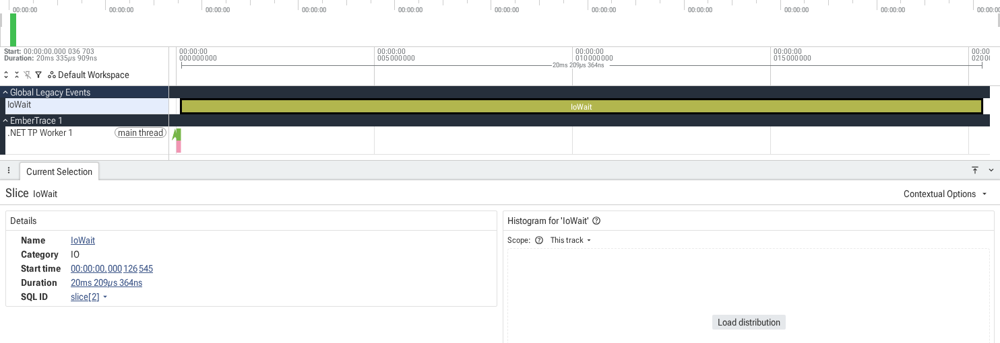
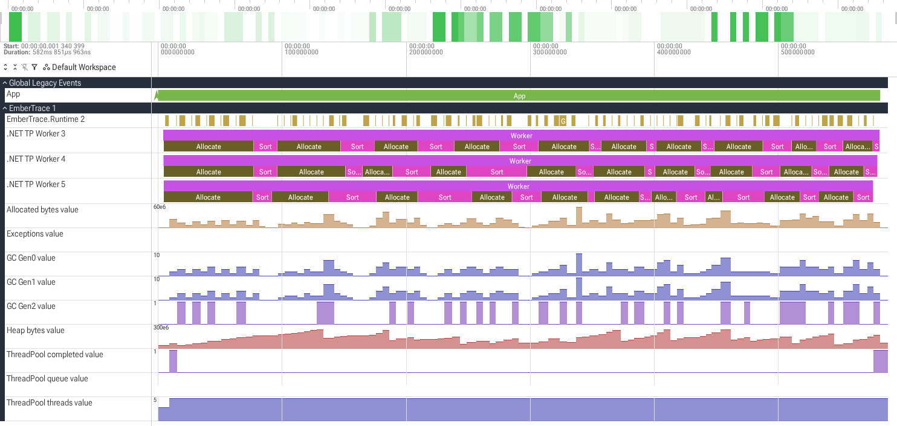
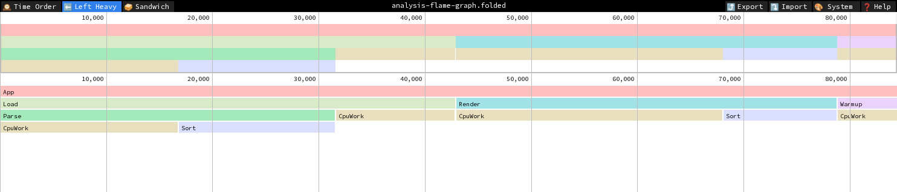

<div align="center">

[](https://www.nuget.org/packages/EmberTrace.All)

# EmberTrace

**Быстрый трассировщик и профилировщик для .NET внутри процесса.**
Scope, flow и счётчики на горячем пути без аллокаций. Отчёты, трассы для Perfetto и flight recorder появляются после записи и не мешают исполняемому коду.

[English](https://github.com/Echways/EmberTrace/blob/main/README.md) · **Русский**

[](https://www.nuget.org/packages/EmberTrace.All)
[](https://github.com/Echways/EmberTrace/actions/workflows/ci.yml)
[](https://github.com/Echways/EmberTrace/blob/main/LICENSE)

</div>

```csharp
Tracer.Start();

using (Tracer.Scope(Ids.Checkout))
{
    Checkout(order);
}

var session = Tracer.Stop();
Console.WriteLine(TraceText.Write(session.Process(), Tracer.CreateMetadata()));
```



## Почему EmberTrace

Профилировщик полезен, когда его можно оставить включённым и верить его цифрам. EmberTrace делает запись дешёвой, а всю работу переносит на момент после сессии.

- **Дешёвая запись.** `Scope`, `Instant`, `Counter` и flow-события не аллоцируют и не берут блокировок: писатели используют thread-local буферы, а общее состояние затрагивается только при ротации чанка и при заданном лимите.
- **Понимает async.** `ScopeAsync` переживает смену потока в continuation и сохраняет родителя через `await`. Flow связывает работу, у которой нет общего стека вызовов.
- **Инструментация атрибутом.** `[Trace]` на `partial`-методе генерирует scope, id и метаданные. На классе он генерирует DI-декоратор для всего сервиса.
- **Всегда включён.** Flight recorder держит последние секунды в памяти. `Tracer.Snapshot()` выгружает их, не останавливая сессию, а хостинг ASP.NET Core умеет делать это по запросу или для каждого медленного запроса.
- **Анализ после записи.** Агрегаты, перцентили с формой распределения, текстовые отчёты, flame graph и статистически корректное сравнение двух наборов прогонов.
- **Открывается где угодно.** Chrome Trace и Perfetto, speedscope, спаны OpenTelemetry и компактный бинарный формат `.ember`.
- **Страж в CI.** `EmberTrace.Testing` превращает трассу в проверки и гейты регрессий.
- **Правильное использование по построению.** Roslyn-анализаторы ловят scope, который не освобождается, и flow, который не закрывается.

`ScopeAsync` аллоцирует около 224 байт на scope, чтобы пронести родителя через `await`; сгенерированный `[Trace]` async-метод платит примерно половину.

## Установка

```shell
dotnet add package EmberTrace.All
```

Требуется .NET 10. Метапакет приносит runtime, генератор, анализ, экспорт и текстовые отчёты. Чтобы выбрать части самостоятельно:

| Пакет | Содержимое |
| ----- | ---------- |
| `EmberTrace` | Runtime API: `Tracer.*`. |
| `EmberTrace.Abstractions` | Атрибуты: `[assembly: TraceId(...)]`, `[Trace]`. |
| `EmberTrace.Generator` | Source generator: регистрирует метаданные и генерирует обёртки `[Trace]`. |
| `EmberTrace.Analysis` | Обработка сессии: `session.Process()`. |
| `EmberTrace.ReportText` | Текстовые отчёты: `TraceText.Write(...)`. |
| `EmberTrace.Export` | Экспорт в Chrome Trace: `TraceExport.*`. |
| `EmberTrace.Format` | Бинарные файлы сессии: `TraceFormat.Write` и `Read`. |
| `EmberTrace.OpenTelemetry` | Экспорт в спаны `Activity`. |
| `EmberTrace.Extensions.Hosting` | ASP.NET Core: `AddEmberTrace()`, scope запросов, `/embertrace/dump`. |
| `EmberTrace.Testing` | Проверки производительности и сравнение с базовой линией: `stats.Scope(...)`, `TraceBudget`. |
| `EmberTrace.RoslynAnalyzers` | Анализаторы и code fix. |

## Быстрый старт

Один раз опишите id и метаданные на уровне assembly:

```csharp
using EmberTrace.Abstractions.Attributes;

[assembly: TraceId(1000, "App", "App")]
[assembly: TraceId(2000, "Worker", "Workers")]
```

Оберните интересующий код в scope:

```csharp
using EmberTrace;

Tracer.Start();

using (Tracer.Scope(1000))
{
    DoWork();
}

var session = Tracer.Stop();
```

Выведите отчёт и запишите файл трассы:

```csharp
var processed = session.Process();
var meta = Tracer.CreateMetadata();

Console.WriteLine(TraceText.Write(processed, meta: meta, topHotspots: 20, maxDepth: 8));

using var file = File.Create("out/trace.json");
TraceExport.WriteChromeComplete(session, file, meta: meta);
```

Откройте `out/trace.json` в [Perfetto](https://ui.perfetto.dev) или `chrome://tracing`.



## Что внутри

| Область | Возможности |
| ------- | ----------- |
| Запись | Scope, async scope, instant, счётчики, flow, runtime-счётчики GC, памяти, пула потоков и исключений. |
| Инструментация | `[Trace]` на методах и классах, метаданные `TraceId`, анализаторы с code fix. |
| Живой захват | Flight recorder, `Tracer.Snapshot()`, endpoint дампа ASP.NET Core, захват медленных запросов. |
| Анализ | Hotspots, деревья вызовов, перцентили, определение бимодальности, сравнение наборов прогонов, collapsed stacks. |
| Выгрузка | Chrome Trace, Perfetto, speedscope, OpenTelemetry, файлы `.ember`, CSV. |
| Тесты | Бюджеты задержек и гейты регрессий для MSTest, xUnit и NUnit. |



## Измерение коротких операций

Scope стоит здесь около 157 нс (`ScopeBenchmarks`, `Scope_BeginEnd_SingleThread`; два вызова `Stopwatch.GetTimestamp()` стоят около 61 нс), поэтому scope вокруг операции размером в микросекунду измеряет в основном самого себя. Оборачивайте пачку операций одним scope и проверяйте цену на своей машине через `OverheadCalibration.Measure()`. См. [Использование и API](https://github.com/Echways/EmberTrace/blob/main/docs/guides/usage/README.ru.md#измерение-коротких-операций).

## Документация

| | |
| - | - |
| [Быстрый старт](https://github.com/Echways/EmberTrace/blob/main/docs/guides/getting-started/README.ru.md) | Установка, id, первая трасса |
| [Использование и API](https://github.com/Echways/EmberTrace/blob/main/docs/guides/usage/README.ru.md) | Сессии, scope, настройки |
| [Автоинструментация](https://github.com/Echways/EmberTrace/blob/main/docs/guides/auto-instrumentation/README.ru.md) | `[Trace]` и DI-декоратор |
| [Flow](https://github.com/Echways/EmberTrace/blob/main/docs/concepts/flows/README.ru.md) | Связи между потоками и через `await` |
| [Экспорт](https://github.com/Echways/EmberTrace/blob/main/docs/guides/export/README.ru.md) | Chrome Trace и Perfetto |
| [Анализ и отчёты](https://github.com/Echways/EmberTrace/blob/main/docs/guides/analysis/README.ru.md) | Перцентили, отчёты, сравнение |
| [Flight recorder](https://github.com/Echways/EmberTrace/blob/main/docs/guides/flight-recorder/README.ru.md) | Снапшоты живой сессии |
| [Хостинг ASP.NET Core](https://github.com/Echways/EmberTrace/blob/main/docs/guides/hosting/README.ru.md) | Scope запросов, endpoint дампа |
| [Тесты производительности](https://github.com/Echways/EmberTrace/blob/main/docs/guides/testing/README.ru.md) | Бюджеты и гейты регрессий |
| [Генератор и метаданные](https://github.com/Echways/EmberTrace/blob/main/docs/reference/source-generator/README.ru.md) | `TraceId`, диагностики |
| [Устранение неполадок](https://github.com/Echways/EmberTrace/blob/main/docs/troubleshooting/README.ru.md) | Симптомы, причины, решения |

Полный список — в [оглавлении документации](https://github.com/Echways/EmberTrace/blob/main/docs/README.ru.md).

## Примеры

| Пример | Что показывает |
| ------ | -------------- |
| [`BasicTracing`](samples/EmberTrace.BasicTracing) | Scope, текстовый отчёт с перцентилями, Chrome Trace, collapsed stacks, запись и чтение `.ember`. |
| [`ParallelWorkers`](samples/EmberTrace.ParallelWorkers) | Рабочие потоки, flow и `AnalyzeFlows`, runtime-счётчики. |
| [`AutoInstrumentation`](samples/EmberTrace.AutoInstrumentation) | `[Trace]` на `partial`-методах. |
| [`FlightRecorder`](samples/EmberTrace.FlightRecorder) | `Tracer.Snapshot()` поверх ограниченного буфера `DropOldest`. |
| [`WebApi`](samples/EmberTrace.WebApi) | Хостинг ASP.NET Core, `/embertrace/dump`, захват медленных запросов. |
| [`NativeAot`](samples/EmberTrace.NativeAot) | Публикация NativeAOT. |
| [`DocScreenshots`](samples/EmberTrace.DocScreenshots) | Все сценарии, из которых получены изображения в `docs/assets`. |

```shell
dotnet run --project samples/EmberTrace.BasicTracing -c Release -p:UseLocalEmberTrace=true
```

Файлы появятся в `./out`. `-p:UseLocalEmberTrace=true` собирает пример на исходниках этого репозитория, а не на опубликованных пакетах.

## Разработка

Нужен SDK, закреплённый в `global.json`.

```shell
dotnet build -c Release
dotnet test -c Release
```

Бенчмарки и NativeAOT:

```shell
dotnet run --project benchmarks/EmberTrace.Benchmarks -c Release -- --filter *ScopeBenchmarks*
dotnet publish samples/EmberTrace.NativeAot -c Release -p:PublishAot=true
```

Изображения в `docs/assets` перегенерируются командой `python3 samples/EmberTrace.DocScreenshots/capture.py`; для неё нужны Playwright с Chromium и Pygments.

## Лицензия

[MIT](https://github.com/Echways/EmberTrace/blob/main/LICENSE)
