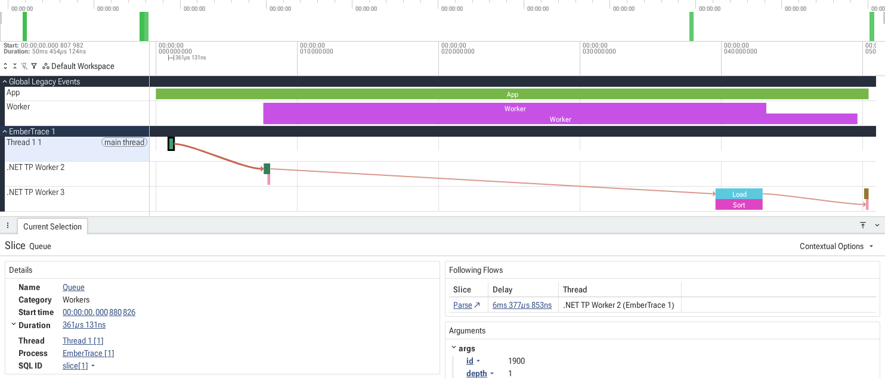

# Flow и async

[English](README.md) · [Русский](README.ru.md) · [Документация](../../README.ru.md)

**Flow** — это связь между кусками работы, которые происходят не в одном стеке вызовов:
- разные потоки
- `Task.Run`
- продолжения после `await`

В Chrome Trace/Perfetto Flow обычно отображается как «стрелка» или связанная цепочка событий.



## FlowHandle

```csharp
var flow = Tracer.FlowStartNewHandle(Ids.JobFlow);

flow.Step();
DoWork();

await Task.Delay(10);
flow.Step();

flow.End();
```

`FlowHandle` удобен, когда нужно держать один объект-цепочку и добавлять шаги по мере выполнения.

## FlowScope

```csharp
using var flow = Tracer.Flow(Ids.JobFlow);
flow.Step();
```

`FlowScope` автоматически завершает flow в `Dispose()`. Можно получить `FlowHandle` через `ToHandle()`,
если нужно передать цепочку между потоками.

## Явный `flowId`

Передавайте id сами, когда он должен пройти через ваш код.

```csharp
var flowId = Tracer.NewFlowId();

Tracer.FlowStart(Ids.JobFlow, flowId);
Stage();
Tracer.FlowStep(Ids.JobFlow, flowId);
Stage();
Tracer.FlowEnd(Ids.JobFlow, flowId);
```

## Activity.Current

Если используется `Activity.Current`, можно связать flow с текущим trace id:

```csharp
Tracer.FlowFromActivityCurrent(Ids.JobFlow);
```

## Практические правила

- Всегда закрывайте flow (`End`), иначе цепочка будет «оборвана» в визуализации.
- Flow — это **связь**, а не длительность. Длительность даёт `Scope`.
- Хороший кейс: связать «приняли запрос» → «поставили в очередь» → «обработали» → «ответили».
- Точке flow не нужен синхронный scope вокруг. Внутри scope'а стрелка крепится к нему; вне scope'а экспорт
  добавляет слайс-маркер нулевой длительности, к которому крепится стрелка.

## См. также

- [Экспорт](../../guides/export/README.ru.md)
- [Использование и API](../../guides/usage/README.ru.md)
