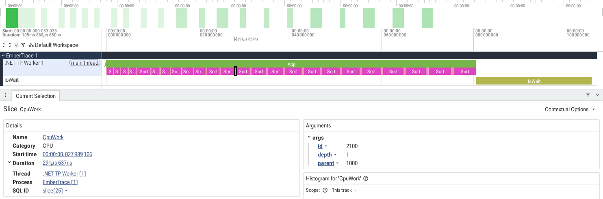
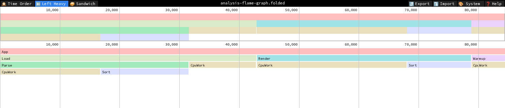

Русская версия: [./README.ru.md](./README.ru.md)

# Analysis and reports

After `Tracer.Stop()`, you can perform heavy trace processing: compute aggregates and print a report.

## Processing

```csharp
var session = Tracer.Stop();
var processed = session.Process();
```

`Process()` builds aggregates by id and call tree (by threads), which are convenient to:
- print in a report
- compare across runs
- use in your own tools
`ProcessedTrace` also stores dropped/sampled counters and stack errors.

Additional modes:

```csharp
var processed = session.Process(strict: true, groupByThread: false);
```

- `strict` - does not attempt stack repair for mismatched end
- `groupByThread` - when `false`, builds a global call tree

One `ThreadTrace` is one writer track, not one managed thread id: `TrackId` is what the tree was grouped
by, `ThreadId` is the managed thread that wrote it and is there for display. Two entries can therefore
carry the same `ThreadId` when the runtime recycled it during the session, and `ThreadsSeen` counts
tracks, so it does not undercount in that case.

For lightweight diagnostics:

```csharp
var stats = session.Analyze(strict: true);
```

Flow chain analysis is also available:

```csharp
var flows = session.AnalyzeFlows(top: 10);
```

## Percentiles

`Analyze()` attaches a duration distribution to every id:

```csharp
var stats = session.Analyze();

foreach (var row in stats.ByTotalTimeDesc)
    Console.WriteLine($"{row.Id}: p50={row.P50Ms:F3} p95={row.P95Ms:F3} p99={row.P99Ms:F3} max={row.MaxMs:F3}");
```

`row.Durations` is the underlying `DurationHistogram` when an arbitrary percentile is needed:
`row.Durations.PercentileTicks(99.9)`.

`Process()` attaches the same distribution to every `HotspotRow` as `P50Ms`, `P95Ms` and `P99Ms`.

Percentiles are exact while an id has at most `maxSamplesPerId` completions (default 100 000, set by
`session.Analyze(maxSamplesPerId: ...)`; `0` keeps none): `row.IsExact` is `true`, `row.Samples` holds the durations in
ticks in the order the scopes closed, and the percentile is the nearest-rank value of that sample. Beyond the limit the
percentiles come from the histogram, which buckets with 8 significant bits: at most 0.39% relative error, always
rounded up, exact below 512 ticks, and `IsExact` is `false`. `MinMs` and `MaxMs` are exact either way.

## Distribution shape and warm-up

A median describes a scope only if the durations form one cluster. For an exact id, `row.Shape` holds `P25Ms`, `P75Ms`,
`MeanMs` and Sarle's bimodality coefficient. `IsBimodal` is set when the coefficient exceeds 5/9 with at least 8
samples; `MedianReliable` is `false` when the distribution is bimodal or the mean differs from the median by more than
25%. Reports from `TraceText.Write` then mark the scope with `*` and print a
`median unreliable` footnote; `includePercentiles: true` adds the `p25` and `p75` columns; percentiles of a scope that is not exact are prefixed with `~` and the report explains it in a footnote.

`row.Warmup(windows: 10)` returns the median of consecutive windows of the samples, which shows whether a scope speeds
up (JIT, caches) or slows down over the run.

## Comparing sets of runs

To compare two versions, run each several times in separate processes and compare the sets, not single traces:

```csharp
var a = files.A.Select(f => TraceRun.FromSession(TraceFormat.Read(f), f)).ToList();
var b = files.B.Select(f => TraceRun.FromSession(TraceFormat.Read(f), f)).ToList();

var comparison = RunSetComparison.Compare(a, b);

foreach (var scope in comparison.Scopes)
    Console.WriteLine($"{scope.Name}: {scope.Change} {scope.ChangePercent:+0.0;-0.0}% " +
                      $"[{scope.CiLowPercent:F1}, {scope.CiHighPercent:F1}] p={scope.MannWhitneyP:F3} {scope.Reason}");
```

The unit of observation is the process: scopes inside one process are correlated, so each run contributes one value per
scope (its median, or mean with `Statistic.Mean`). The change is the ratio of the medians of those values; its
confidence interval comes from a two-level bootstrap (rounds, then processes within a round; fixed `Seed`), and the
Mann-Whitney U p-value is reported next to it. A scope needs at least 3 runs per arm. The verdict is `Regressed` or
`Improved` only when the whole interval lies beyond `ChangeThresholdPercent`, `Unchanged` when it lies within, and
`Inconclusive` otherwise, with the reason in `Reason`.

Tag runs with `SessionOptions.Tags` (`arm`, `round`) and `TraceRun.FromSession` reads them. Runs that overflowed or
dropped events are excluded and listed in `ExcludedRuns`. `Mismatches` lists environment differences (CPU governor,
turbo, runtime, GC, affinity, cgroup limits are `Blocking`); a run from a file written before format version 2 has no
environment and yields a warning. A scope whose median is unreliable in most runs of an arm is `Inconclusive` under
`Statistic.Median`.

## CSV table

`TraceText.WriteScopeTable(runs, writer)` writes one row per run and scope (`run,arm,round,id,name,count,total_ms,
mean_ms,min_ms,p25_ms,p50_ms,p75_ms,p95_ms,p99_ms,max_ms,exact,bimodal,overflow,dropped`) with `.` as the decimal
separator, for plotting and external statistics.

## Text report

```csharp
var meta = Tracer.CreateMetadata();

var text = TraceText.Write(
    processed,
    meta: meta,
    topHotspots: 20,
    maxDepth: 8,
    categoryFilter: "IO",
    minPercent: 1,
    includePercentiles: true);

Console.WriteLine(text);
```

Parameters:
- `topHotspots` - number of hotspot lines to show
- `maxDepth` - call tree depth
- `categoryFilter` - category filter
- `minPercent` - minimum percentage to display
- `includePercentiles` - adds p50/p95/p99 columns to the hotspots table

See also:
- [Performance testing and regression gates](../testing/README.md)
- [Export](../export/README.md)
- [Usage and API](../usage/README.md)

## Flame graphs

`TraceText.WriteCollapsedStacks` writes the merged call tree as collapsed stacks — one `Outer;Inner 4000` line per
call path, weighted by exclusive microseconds. Threads are merged. The output opens in
[speedscope](https://www.speedscope.app), `flamegraph.pl`, `inferno-flamegraph` and Grafana Pyroscope.

```csharp
using var file = File.CreateText("out/trace.folded");
TraceText.WriteCollapsedStacks(session.Process(), file, Tracer.CreateMetadata());
```

In a snapshot, scopes still open at the cut are weighed up to the cut, so an in-flight request shows the time it has
spent so far; hotspots and percentiles count only finished scopes. Scopes that began before the snapshot's window
are missing — widen the window to see them. Concurrent async children are each weighed by their own time, so a
parent that fans out with `Task.WhenAll` is drawn wider than it ran.

## Screenshots





## Links

- [**Analysis slice**](../../assets/analysis-slice.txt)
