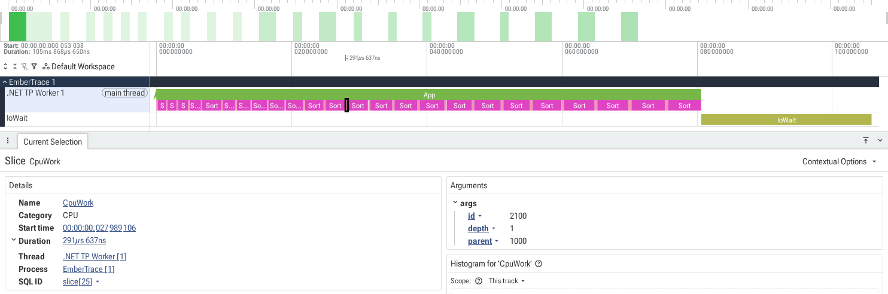
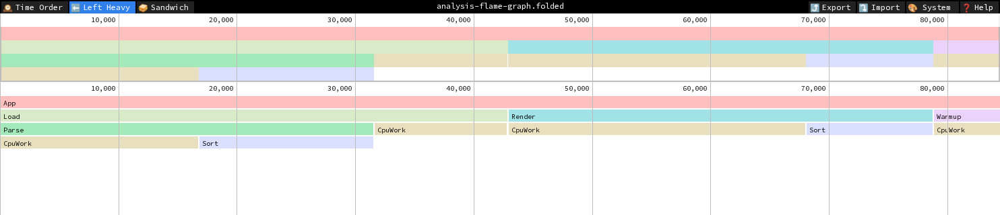

# Анализ и отчёты

[English](README.md) · [Русский](README.ru.md) · [Документация](../../README.ru.md)

После `Tracer.Stop()` можно «тяжело» обработать трассу: посчитать агрегаты и вывести отчёт.

## Обработка

```csharp
var session = Tracer.Stop();
var processed = session.Process();
```

`Process()` строит агрегаты по id и call-tree (по потокам), которые удобно:
- печатать в отчёте
- сравнивать между прогонами
- использовать в своих инструментах

В `ProcessedTrace` также сохраняются счётчики dropped/sampled и ошибки стека.

Дополнительные режимы:

```csharp
var processed = session.Process(strict: true, groupByThread: false);
```

| Параметр | Смысл |
| -------- | ----- |
| `strict` | Не восстанавливает стек при несовпадающем end. |
| `groupByThread` | Если `false`, строится одно общее дерево вызовов. |

Один `ThreadTrace` — это одна дорожка писателя, а не один managed thread id: `TrackId` — то, по чему
сгруппировано дерево, `ThreadId` — поток, который его писал, и нужен для отображения. Поэтому две
записи могут иметь одинаковый `ThreadId`, если рантайм переиспользовал его в течение сессии, а
`ThreadsSeen` считает дорожки и в этом случае не занижает результат.

Для лёгкой диагностики:

```csharp
var stats = session.Analyze(strict: true);
```

Также доступен анализ flow‑цепочек:

```csharp
var flows = session.AnalyzeFlows(top: 10);
```

## Перцентили

`Analyze()` прикладывает к каждому id распределение длительностей:

```csharp
var stats = session.Analyze();

foreach (var row in stats.ByTotalTimeDesc)
    Console.WriteLine($"{row.Id}: p50={row.P50Ms:F3} p95={row.P95Ms:F3} p99={row.P99Ms:F3} max={row.MaxMs:F3}");
```

`row.Durations` — это сама гистограмма `DurationHistogram`, если нужен произвольный перцентиль:
`row.Durations.PercentileTicks(99.9)`.

`Process()` прикладывает то же распределение к каждой строке `HotspotRow` как `P50Ms`, `P95Ms` и `P99Ms`.

Перцентили точные, пока у id не больше `maxSamplesPerId` завершений (по умолчанию 100 000, задаётся
`session.Analyze(maxSamplesPerId: ...)`; `0` отключает выборки): `row.IsExact` равен `true`, `row.Samples` хранит
длительности в тиках в порядке закрытия scope'ов, а перцентиль — значение по методу nearest-rank из этой выборки. Сверх
лимита перцентили берутся из гистограммы с 8 значащими битами: относительная погрешность не более 0,39%, значение
всегда округляется вверх, ниже 512 тиков результат точный, `IsExact` равен `false`. `MinMs` и `MaxMs` точные в обоих
случаях.

## Форма распределения и прогрев

Медиана описывает scope, только если длительности образуют один кластер. Для точного id `row.Shape` содержит `P25Ms`,
`P75Ms`, `MeanMs` и коэффициент бимодальности Сарла. `IsBimodal` выставляется, когда коэффициент больше 5/9 при не менее
чем 8 замерах; `MedianReliable` равен `false`, если распределение бимодально или среднее отличается от медианы более
чем на 25%. Отчёты `TraceText.Write` тогда помечают scope `*` и печатают сноску `median unreliable`;
`includePercentiles: true` добавляет колонки `p25` и `p75`; перцентили неточного scope'а получают префикс `~`, а отчёт поясняет это сноской.

`row.Warmup(windows: 10)` возвращает медиану последовательных окон выборки и показывает, ускоряется scope (JIT, кэши)
или замедляется за время прогона.

## Сравнение наборов запусков

Чтобы сравнить две версии, запустите каждую несколько раз в отдельных процессах и сравнивайте наборы, а не отдельные трассы:

```csharp
var a = files.A.Select(f => TraceRun.FromSession(TraceFormat.Read(f), f)).ToList();
var b = files.B.Select(f => TraceRun.FromSession(TraceFormat.Read(f), f)).ToList();

var comparison = RunSetComparison.Compare(a, b);

foreach (var scope in comparison.Scopes)
    Console.WriteLine($"{scope.Name}: {scope.Change} {scope.ChangePercent:+0.0;-0.0}% " +
                      $"[{scope.CiLowPercent:F1}, {scope.CiHighPercent:F1}] p={scope.MannWhitneyP:F3} {scope.Reason}");
```

Единица наблюдения — процесс: scope'ы внутри одного процесса коррелированы, поэтому каждый запуск даёт одно значение на
scope (его медиану, либо среднее при `Statistic.Mean`). Изменение — отношение медиан этих значений; доверительный
интервал строится двухуровневым бутстрапом (раунды, затем процессы внутри раунда; `Seed` фиксирован), рядом выводится
p-value критерия Манна—Уитни. Для scope'а нужно не менее 3 запусков в каждом плече. Вердикт `Regressed` или `Improved`
выдаётся, только если весь интервал лежит за `ChangeThresholdPercent`, `Unchanged` — если целиком внутри порога, иначе
`Inconclusive` с причиной в `Reason`.

Помечай запуски через `SessionOptions.Tags` (`arm`, `round`), `TraceRun.FromSession` их прочитает; для сессии без тега `arm` или `round` их нужно передать явно, иначе будет исключение. Запуски с
переполнением или потерянными событиями исключаются и перечисляются в `ExcludedRuns`. `Mismatches` содержит различия
окружения (governor, turbo, рантайм, GC, affinity, лимиты cgroup — `Blocking`); запуск из файла до версии формата 2
не имеет окружения и даёт предупреждение. Scope, у которого медиана ненадёжна в большинстве запусков плеча, при
`Statistic.Median` получает `Inconclusive`.

## CSV-таблица

`TraceText.WriteScopeTable(runs, writer)` пишет строку на каждую пару «запуск × scope»
(`run,arm,round,id,name,count,total_ms,mean_ms,min_ms,p25_ms,p50_ms,p75_ms,p95_ms,p99_ms,max_ms,exact,bimodal,overflow,dropped`)
с точкой как десятичным разделителем, для графиков и внешней статистики.

## Текстовый отчёт

```csharp
var meta = Tracer.CreateMetadata();

var text = TraceText.Write(
    processed,
    meta: meta,
    topHotspots: 20,
    maxDepth: 8,
    categoryFilter: "IO",
    minPercent: 1,
    includePercentiles: true);

Console.WriteLine(text);
```

| Параметр | Смысл |
| -------- | ----- |
| `topHotspots` | Сколько строк горячих точек показать. |
| `maxDepth` | Глубина дерева вызовов. |
| `categoryFilter` | Показывать только эту категорию. |
| `minPercent` | Минимальная доля для вывода. |
| `includePercentiles` | Добавляет колонки p50, p95 и p99 в таблицу горячих точек. |



[Текстовый отчёт](../../assets/analysis-slice.txt) этой сессии лежит рядом с изображением.

## Флейм-графы

`TraceText.WriteCollapsedStacks` пишет объединённое дерево вызовов в формате collapsed stacks — по строке
`Outer;Inner 4000` на каждый путь вызова, вес — эксклюзивное время в микросекундах. Потоки объединяются. Результат
открывается в [speedscope](https://www.speedscope.app), `flamegraph.pl`, `inferno-flamegraph` и Grafana Pyroscope.

```csharp
using var file = File.CreateText("out/trace.folded");
TraceText.WriteCollapsedStacks(session.Process(), file, Tracer.CreateMetadata());
```

В снапшоте scope'ы, открытые на момент среза, учитываются до среза, поэтому запрос, который ещё выполняется, виден
со временем, потраченным на данный момент; hotspots и перцентили считают только завершённые scope'ы. Scope'ов,
начавшихся до окна снапшота, в нём нет — расширьте окно, чтобы их увидеть. Параллельные асинхронные дочерние scope'ы
учитываются каждый со своим временем, поэтому родитель, распараллеливший работу через `Task.WhenAll`, рисуется шире,
чем выполнялся.



## См. также

- [Тесты производительности и гейты регрессий](../testing/README.ru.md)
- [Экспорт](../export/README.ru.md)
- [Использование и API](../usage/README.ru.md)
