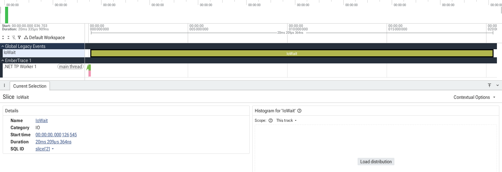

# Quick start

[English](README.md) · [Русский](README.ru.md) · [Documentation](../../README.md)

This page takes an empty project to a recorded trace: a few scopes, a text report and a file that opens in Perfetto.

## Requirements

- .NET 10 and the SDK pinned in `global.json` when you build this repository.

## Installation

The metapackage brings the runtime, the generator, analysis, export and text reports:

```shell
dotnet add package EmberTrace.All
```

To pick the parts yourself, the runtime alone is enough to record:

```shell
dotnet add package EmberTrace
```

Names and categories in reports and exports come from metadata. Add the attributes and the generator that registers them:

```shell
dotnet add package EmberTrace.Abstractions
dotnet add package EmberTrace.Generator
```

`EmberTrace.Generator` is a source generator. It collects `[assembly: TraceId(...)]` and registers the metadata through a `ModuleInitializer`. Reports and exports need `EmberTrace.Analysis`, `EmberTrace.ReportText` and `EmberTrace.Export`; the [package list](../../../README.md#installation) describes every package.

## Ids and metadata

Declare ids at the assembly level, in any file, for example `TraceIds.cs`:

```csharp
using EmberTrace.Abstractions.Attributes;

[assembly: TraceId(1000, "App", "App")]
[assembly: TraceId(2000, "Worker", "Workers")]
[assembly: TraceId(2100, "IoWait", "IO")]
```

- Give each module or subsystem its own range, for example `1000-1999` and `2000-2999`.
- Keep names short and stable: they go into reports and exports.

## Recording

```csharp
using EmberTrace;

Tracer.Start();

using (Tracer.Scope(1000))
{
    DoWork();
}

var session = Tracer.Stop();
```

`Scope` is a `ref struct` and cannot cross an `await`. In `async` code use `ScopeAsync`:

```csharp
await using (Tracer.ScopeAsync(2100))
{
    await Task.Delay(50);
}
```

## Report

```csharp
var processed = session.Process();
var meta = Tracer.CreateMetadata();

Console.WriteLine(TraceText.Write(processed, meta: meta, topHotspots: 20, maxDepth: 8));
```

## Trace file

```csharp
Directory.CreateDirectory("out");

using var file = File.Create("out/trace.json");
TraceExport.WriteChromeComplete(session, file, meta: meta);
```

Open `out/trace.json` in `chrome://tracing` or in the [Perfetto](https://ui.perfetto.dev) web UI, which suits large traces better.



The [text report](../../assets/getting-started-first-trace.txt) of the same session is kept next to the image.

## A ready-made scenario

The repository holds a scenario with scopes, flows, `async` code, export and a report:

```shell
dotnet run --project samples/EmberTrace.DocScreenshots -c Release -p:UseLocalEmberTrace=true
```

The files appear in `samples/EmberTrace.DocScreenshots/out`.

## What to read next

| If you want to | Read |
| -------------- | ---- |
| Learn sessions, scopes and options | [Usage and API](../usage/README.md) |
| Instrument methods with an attribute | [Auto-instrumentation](../auto-instrumentation/README.md) |
| Follow work across threads and `await` | [Flows](../../concepts/flows/README.md) |
| Read the numbers | [Analysis and reports](../analysis/README.md) |
| Leave tracing on in a service | [Flight recorder](../flight-recorder/README.md) |
