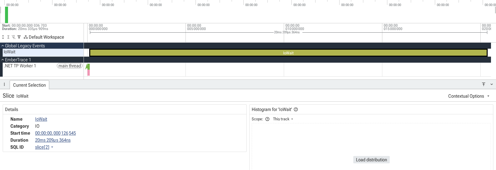

# Быстрый старт

[English](README.md) · [Русский](README.ru.md) · [Документация](../../README.ru.md)

Эта страница ведёт от пустого проекта к записанной трассе: несколько scope, текстовый отчёт и файл, который открывается в Perfetto.

## Требования

- .NET 10 и SDK, закреплённый в `global.json`, если вы собираете этот репозиторий.

## Установка

Метапакет приносит runtime, генератор, анализ, экспорт и текстовые отчёты:

```shell
dotnet add package EmberTrace.All
```

Чтобы выбрать части самостоятельно: для записи достаточно одного runtime.

```shell
dotnet add package EmberTrace
```

Имена и категории в отчётах и экспорте берутся из метаданных. Добавьте атрибуты и генератор, который их регистрирует:

```shell
dotnet add package EmberTrace.Abstractions
dotnet add package EmberTrace.Generator
```

`EmberTrace.Generator` — source generator. Он собирает `[assembly: TraceId(...)]` и регистрирует метаданные через `ModuleInitializer`. Для отчётов и экспорта нужны `EmberTrace.Analysis`, `EmberTrace.ReportText` и `EmberTrace.Export`; все пакеты описаны в [списке пакетов](../../../README.ru.md#установка).

## Id и метаданные

Объявите id на уровне assembly, в любом файле, например `TraceIds.cs`:

```csharp
using EmberTrace.Abstractions.Attributes;

[assembly: TraceId(1000, "App", "App")]
[assembly: TraceId(2000, "Worker", "Workers")]
[assembly: TraceId(2100, "IoWait", "IO")]
```

- Выделите каждому модулю или подсистеме свой диапазон, например `1000-1999` и `2000-2999`.
- Делайте имена короткими и стабильными: они попадают в отчёты и экспорт.

## Запись

```csharp
using EmberTrace;

Tracer.Start();

using (Tracer.Scope(1000))
{
    DoWork();
}

var session = Tracer.Stop();
```

`Scope` — `ref struct`, его нельзя переносить через `await`. В `async`-коде используйте `ScopeAsync`:

```csharp
await using (Tracer.ScopeAsync(2100))
{
    await Task.Delay(50);
}
```

## Отчёт

```csharp
var processed = session.Process();
var meta = Tracer.CreateMetadata();

Console.WriteLine(TraceText.Write(processed, meta: meta, topHotspots: 20, maxDepth: 8));
```

## Файл трассы

```csharp
Directory.CreateDirectory("out");

using var file = File.Create("out/trace.json");
TraceExport.WriteChromeComplete(session, file, meta: meta);
```

Откройте `out/trace.json` в `chrome://tracing` или в веб-интерфейсе [Perfetto](https://ui.perfetto.dev): он лучше подходит для больших трасс.



[Текстовый отчёт](../../assets/getting-started-first-trace.txt) этой же сессии лежит рядом с изображением.

## Готовый сценарий

В репозитории есть сценарий со scope, flow, `async`-кодом, экспортом и отчётом:

```shell
dotnet run --project samples/EmberTrace.DocScreenshots -c Release -p:UseLocalEmberTrace=true
```

Файлы появятся в `samples/EmberTrace.DocScreenshots/out`.

## Что читать дальше

| Если нужно | Читайте |
| ---------- | ------- |
| Разобраться с сессиями, scope и настройками | [Использование и API](../usage/README.ru.md) |
| Инструментировать методы атрибутом | [Автоинструментация](../auto-instrumentation/README.ru.md) |
| Следить за работой между потоками и через `await` | [Flow](../../concepts/flows/README.ru.md) |
| Прочитать цифры | [Анализ и отчёты](../analysis/README.ru.md) |
| Оставить трассировку включённой в сервисе | [Flight recorder](../flight-recorder/README.ru.md) |
