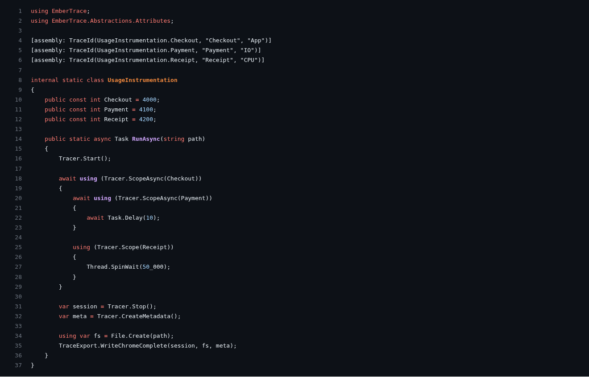

Русская версия: [./README.ru.md](./README.ru.md)

# Usage and API

This page is a practical guide to the runtime API (`EmberTrace`) and common usage patterns.

## Lifecycle

One session = one interval between `Start()` and `Stop()`.

```csharp
Tracer.Start();

using (Tracer.Scope(Ids.App))
{
    // ...
}

var session = Tracer.Stop();
```

Notes:
- nested `Scope` is allowed (you get a call tree)
- events are collected into **thread-local** buffers; heavy processing happens after `Stop()`

## Scopes

### Sync: `Tracer.Scope(int id)`

`Scope` is a `ref struct` (minimal overhead). You **cannot** keep it across `await`.

```csharp
using (Tracer.Scope(Ids.Cpu))
{
    CpuWork();
}
```

### Async: `Tracer.ScopeAsync(int id)`

```csharp
await using (Tracer.ScopeAsync(Ids.Io))
{
    await Task.Delay(10);
}
```

An async scope is matched by its own identity, not by thread, so a continuation that resumes on another thread still produces the correct duration. Scopes opened inside it - including synchronous ones on worker threads - are attached to it as children.

## Identifiers (TraceId)

EmberTrace works with `int id`. There are three convenient strategies:

1) **Constants in code** (most explicit option)

```csharp
static class Ids
{
    public const int App = 1000;
    public const int Io  = 2100;
}
```

2) **Stable id from a string** (when you do not want to keep a constants table)

```csharp
var id = Tracer.Id("MySubsystem.Request");
using var _ = Tracer.Scope(id);
```

Do not call `Tracer.Id` on every scope: it hashes the string and looks the name up each time. Create a `TraceName`
once, in a `static readonly` field, and pass it to `Tracer.Scope`:

```csharp
private static readonly TraceName Request = new("MySubsystem.Request");

using var _ = Tracer.Scope(Request);
```

You can hash categories the same way:

```csharp
var ioCategory = Tracer.CategoryId("IO");
```

3) **Metadata via `[assembly: TraceId(...)]`** - for readable names/categories in reports and export
(see docs: generator).

## Session settings

```csharp
Tracer.Start(new SessionOptions
{
    ChunkCapacity = 128 * 1024,
    OverflowPolicy = OverflowPolicy.DropNew
});
```

- `ChunkCapacity` - size of the event chunk in a thread buffer
- `OverflowPolicy` - overflow behavior (`DropNew`, `DropOldest`, `StopSession`)
- `MaxTotalEvents` / `MaxTotalChunks` - limits for total volume
- `MaxEventsPerSecond` - events-per-second limit per writer thread
- `SampleEveryNGlobal` / `SampleEveryNById` - session-wide sampling without global locks
- `EnabledCategoryIds` / `DisabledCategoryIds` - category filtering

## Session API

After stopping a session:

- `session.EventCount` - total number of events
- `session.EnumerateEvents()` - raw events (for custom tooling)
- `session.EnumerateEventsSorted()` - stable sort by timestamp -> thread -> sequence
- `session.Process()` - aggregates for reports/analytics

```csharp
var processed = session.Process();
```

## Metadata

Metadata is required to turn ids into readable names/categories.

```csharp
var meta = Tracer.CreateMetadata();
```

If `EmberTrace.Generator` is connected, metadata from `[assembly: TraceId(...)]` will be
**registered automatically** at module startup (see [generator](../../reference/source-generator/README.md)).

For dev scenarios, you can enable runtime metadata: `EnableRuntimeMetadata = true`.
In this mode, `Tracer.Id("Name")` automatically registers a name with category `Default`.

## Measuring short operations

A scope has a fixed cost. On the machine used for these figures (`ScopeBenchmarks`, short job on Linux) opening and
closing one takes about 157 ns, against about 61 ns for two `Stopwatch.GetTimestamp()` calls, and `Tracer.Id(...)` on
every call adds about 93 ns more (use a `TraceName`, see above). Run `ScopeBenchmarks` for your own numbers.

For an operation that takes microseconds, one scope per call mostly measures the scope. Wrap a batch instead and divide
by its size:

```csharp
private static readonly TraceName ParseBatch = new("Parse.Batch");

using (Tracer.Scope(ParseBatch))
{
    for (var i = 0; i < items.Length; i++)
        Parse(items[i]);
}
```

The per-item time is `AverageMs / items.Length` of that scope. As a rule, a scope shorter than 20 times its own
overhead should be measured as a batch. `OverheadCalibration.Measure()` runs a private session and returns the cost on
the current machine:

```csharp
var overhead = OverheadCalibration.Measure();

Console.WriteLine($"scope: {overhead.ScopeNs:F0} ns; wrap at least {overhead.MinBatchWorkNs(5):F0} ns of work per scope");
Console.WriteLine(TraceText.Write(session.Process(), includePercentiles: true, overhead: overhead));
```

`MinBatchWorkNs(5)` is the work one scope must wrap for the overhead to stay under 5%; `CorrectMs` subtracts one scope
from a measured duration; the report marks scopes whose median is below 20 times the overhead as
`overhead-dominated`. Run the calibration on the same machine and settings as the measured code, with the tracer stopped.

## Practical recommendations

- Instrument **large** parts of the hot path and external waits (IO/lock/await), not every line.
- Keep IDs stable: either constant ranges or `Tracer.Id("...")` with fixed strings.
- For `async`, always use `ScopeAsync`; otherwise compiler/runtime constraints will block the scenario.

See also:
- [Flow and async](../../concepts/flows/README.md)
- [Export](../export/README.md)
- [Analysis and reports](../analysis/README.md)

## Screenshots


