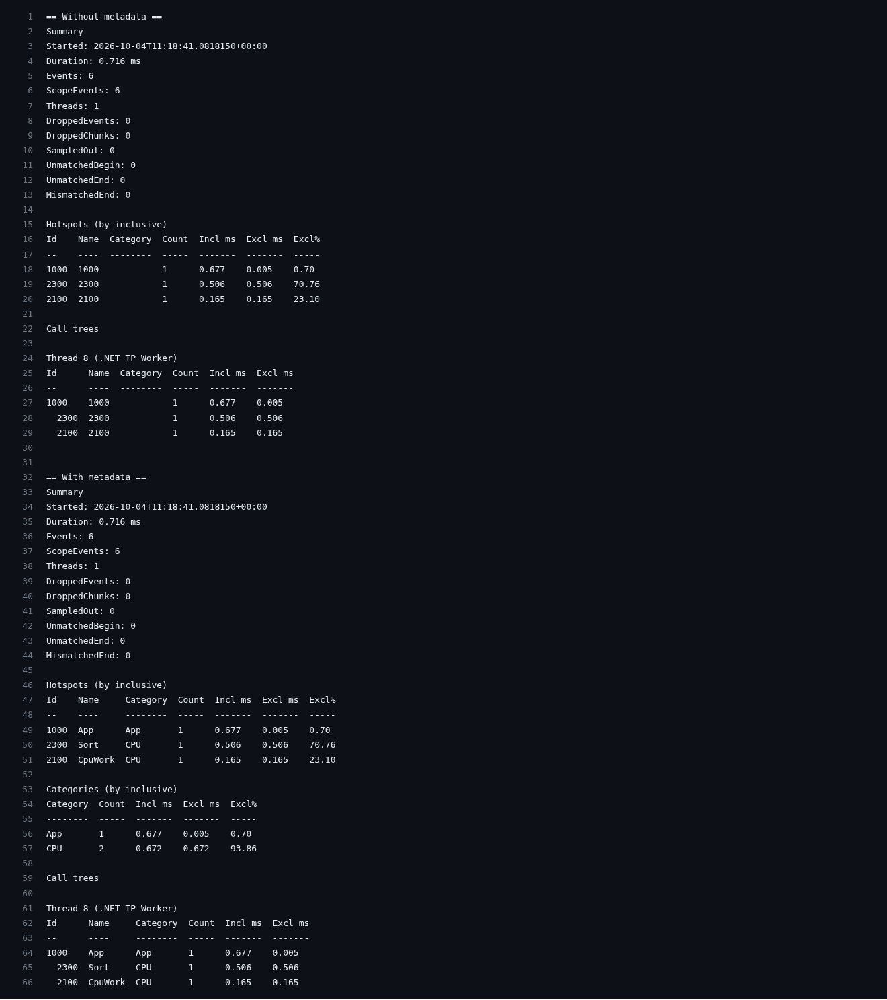

# Troubleshooting

[English](README.md) · [Русский](README.ru.md) · [Documentation](../README.md)

Below are common symptoms, causes, and short fixes.

## No events in the session

**Symptom:** `EventCount == 0`, report is empty.

**Check:**
- `Tracer.Start()` is called **before** the first `Scope/Flow`
- `Tracer.Stop()` was actually called (and the session did not terminate earlier due to an exception)
- id is not `0` (avoid `id == 0` - this is a frequent source of confusion)

## Error/warning about `await` and `Scope`

**Cause:** `Scope` is a `ref struct`; it cannot be carried through `await`.

**Fix:** use `ScopeAsync`.

```csharp
await using (Tracer.ScopeAsync(Ids.Io))
{
    await Task.Delay(10);
}
```

`ScopeAsync` carries its own scope id through `Begin`/`End`, so thread hops across `await` do not break matching or nesting.

## Unmatched begin/end around `await`

**Cause:** an `AsyncScope` that is not disposed in the same async context - it was stored in a field, disposed by another task, or created without `await using`.

**Fix:** always create it in an `await using` statement (analyzer `ETA002` reports the rest).

## No names in the report (only numbers)

**Cause:** metadata is missing.

**Fix:**
- add `[assembly: TraceId(...)]`
- connect `EmberTrace.Abstractions` + `EmberTrace.Generator`
- rebuild the project (the source generator creates and registers the provider at compile time)



## Buffer overflow / "missing events"

**Cause:** thread buffers overflowed and the overflow policy triggered.

**Fix:**
- increase `SessionOptions.ChunkCapacity`
- review instrumentation rate/granularity
- change `OverflowPolicy` if needed (`DropNew`, `DropOldest`, `StopSession`)
- check limits `MaxTotalEvents`, `MaxTotalChunks`, `MaxEventsPerSecond`

## Median and mean disagree

**Cause:** the scope's durations form two clusters (a cached and an uncached path, a lock that is sometimes contended),
so the median follows whichever cluster has more samples and a small shift of the mix moves it a lot. The report marks
such a scope with `*` and `median unreliable`; `row.Shape.IsBimodal` is `true`.

**Fix:**
- read `row.Shape` (`P25Ms`, `P75Ms`, `MeanMs`) and `row.Warmup()` instead of a single number
- split the scope by branch (`Tracer.Scope` per path) so each has one cluster
- when comparing sets of runs, a bimodal scope is `Inconclusive` under `Statistic.Median`: use `Statistic.Mean` or split it

## Runs of the same code disagree / mixed CPU governors

**Cause:** the machine state changed between runs (CPU governor `powersave` against `performance`, turbo, a different
runtime or `DOTNET_*` setting, affinity or cgroup limits).

**Fix:**
- compare `session.Environment` with `EnvironmentCompatibility.Compare`, or read `RunSetComparison.Mismatches`
- check `session.EnvironmentAtStop` against `session.Environment`: a governor that changed during the run shows up there
- set `ComparisonOptions.RequireCompatibleEnvironment` to make every verdict `Inconclusive` while a blocking difference
  exists, and rerun on one fixed configuration

## Flow is "broken"

**Cause:** `FlowEnd(...)` / `handle.End()` was not called.

**Fix:** close flow in `finally` or via explicit lifecycle.

## Only numeric IDs in a dev build

**Cause:** metadata is missing; generator is not connected.

**Fix:** enable `EnableRuntimeMetadata = true` or add `[assembly: TraceId(...)]`.

## See also

- [Usage and API](../guides/usage/README.md)
- [Flow and async](../concepts/flows/README.md)
