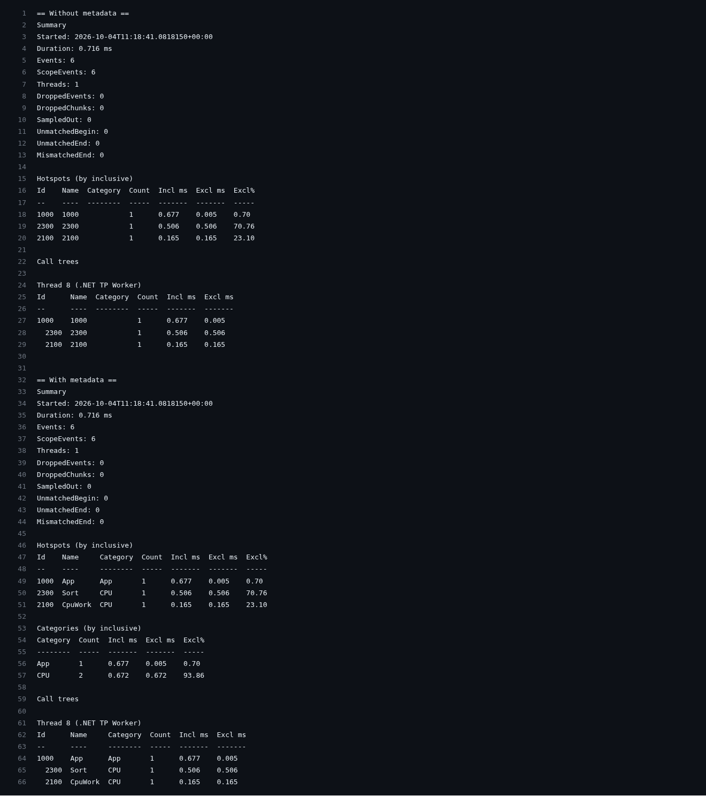

English version: [./README.md](./README.md)

# Устранение неполадок

Ниже — типовые симптомы, причины и короткие фиксы.

## В сессии нет событий

**Симптом:** `EventCount == 0`, отчёт пустой.

**Проверь:**
- `Tracer.Start()` вызван **до** первых `Scope/Flow`
- `Tracer.Stop()` реально был вызван (и сессия не «упала» по исключению раньше)
- id не равен `0` (избегай `id == 0` — это частый источник путаницы)

## Ошибка/предупреждение про `await` и `Scope`

**Причина:** `Scope` — `ref struct`, его нельзя переносить через `await`.

**Решение:** используй `ScopeAsync`.

```csharp
await using (Tracer.ScopeAsync(Ids.Io))
{
    await Task.Delay(10);
}
```

`ScopeAsync` несёт собственный scope id в `Begin`/`End`, поэтому переезд на другой поток через `await` не ломает ни сопоставление, ни вложенность.

## Непарные begin/end вокруг `await`

**Причина:** `AsyncScope` не освобождается в том же async-контексте — сохранён в поле, освобождён другой задачей или создан без `await using`.

**Решение:** всегда создавай его в конструкции `await using` (остальное подсветит анализатор `ETA002`).

## В отчёте нет имён (только числа)

**Причина:** нет метаданных.

**Решение:**
- добавь `[assembly: TraceId(...)]`
- подключи `EmberTrace.Abstractions` + `EmberTrace.Generator`
- пересобери проект (source generator генерирует и регистрирует провайдер при компиляции)

## Переполнение буфера / «пропали события»

**Причина:** буферы потока переполнены, сработала политика overflow.

**Решение:**
- увеличь `SessionOptions.ChunkCapacity`
- пересмотри частоту/гранулярность instrumentation
- при необходимости поменяй `OverflowPolicy` (`DropNew`, `DropOldest`, `StopSession`)
- проверь лимиты `MaxTotalEvents`, `MaxTotalChunks`, `MaxEventsPerSecond`

## Медиана и среднее расходятся

**Причина:** длительности скоупа образуют два кластера (путь с кэшем и без, блокировка, за которую иногда борются), поэтому
медиана следует за кластером с большим числом замеров и сильно сдвигается при небольшом изменении их соотношения.
Отчёт помечает такой скоуп `*` и `median unreliable`; `row.Shape.IsBimodal` равен `true`.

**Решение:**
- смотри `row.Shape` (`P25Ms`, `P75Ms`, `MeanMs`) и `row.Warmup()` вместо одного числа
- раздели скоуп по ветвям (`Tracer.Scope` на каждый путь), чтобы в каждом был один кластер
- при сравнении наборов запусков бимодальный скоуп получает `Inconclusive` при `Statistic.Median`: используй
  `Statistic.Mean` или раздели скоуп

## Запуски одного и того же кода расходятся / смешанные governor процессора

**Причина:** состояние машины менялось между запусками (governor `powersave` против `performance`, turbo, другой рантайм
или настройка `DOTNET_*`, affinity или лимиты cgroup).

**Решение:**
- сравни `session.Environment` через `EnvironmentCompatibility.Compare` или смотри `RunSetComparison.Mismatches`
- сопоставь `session.EnvironmentAtStop` с `session.Environment`: governor, изменившийся за время прогона, виден там
- включи `ComparisonOptions.RequireCompatibleEnvironment`, чтобы любое блокирующее различие делало все вердикты
  `Inconclusive`, и перезапусти на одной фиксированной конфигурации

## Flow «обрывается»

**Причина:** не вызван `FlowEnd(...)` / `handle.End()`.

**Решение:** закрывай flow в `finally` или через явный жизненный цикл.

## Есть только числовые id в dev‑сборке

**Причина:** нет метаданных, generator не подключён.

**Решение:** включи `EnableRuntimeMetadata = true` или добавь `[assembly: TraceId(...)]`.

См. также:
- [Использование и API](../guides/usage/README.ru.md)
- [Flow и async](../concepts/flows/README.ru.md)

## Скриншоты


